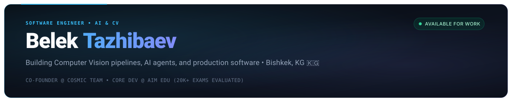

  <!-- Header Banner -->
  

    

  <!-- Minimal Social Badges -->
  

    
    &nbsp;
    
    &nbsp;
    
    &nbsp;
    
  

---

### About

I'm **Belek (Blake)** &mdash; a 17-year-old software systems engineer, computer vision developer, and AI builder from **Bishkek, Kyrgyzstan 🇰🇬**.

- 🔭 **Specialization:** Real-time Computer Vision pipelines, Low-level Hardware Protocols, and Full-Stack SaaS.
- 💼 **Production Experience:** Co-founder at **Cosmic Team** (Commercial Restaurant POS software) & Lead Architect on **AIM EDU** (Scored 20,000+ exam sheets).
- 🤖 **Engineering Philosophy:** Clean-room protocols, zero-latency architectures, and AI-native high-throughput software development.

---

### Impact Metrics

| ⚡ **20,000+** Exam Sheets Graded | 🏫 **6 School Campuses** in Production | 🍽️ **Turnkey POS** with ESC/POS Hardware | 🖐 **Real-Time 60 FPS** Spatial Hand Tracking |
| :---: | :---: | :---: | :---: |

---

### Featured Flagship Projects

- **[GestureBoard (VisualNote)](https://github.com/Nekono3/VisualNote)** &mdash; Spatial gesture-controlled infinite whiteboard workspace. Tracks 21 3D hand landmarks in real-time via MediaPipe with subpixel jitter smoothing and 60 FPS decoupled Canvas rendering.  
  `JavaScript` &bull; `MediaPipe Hands` &bull; `Computer Vision` &bull; `HTML5 Canvas 60FPS` &bull; `Spatial Vectors`

- **[MOUSet (mousely)](https://github.com/Nekono3/mousely)** &mdash; Clean-room zero-install presentation remote and multi-touch trackpad. Turns any iOS/Android smartphone into an ultra-low latency desktop clicker, trackpad, and voice dictation controller over local WebSockets.  
  `Node.js` &bull; `WebSockets (RFC 6455)` &bull; `Cross-Platform (Linux/macOS/Win)` &bull; `Zero-Install PWA`

- **[AIM EDU](https://github.com/Nekono3/AIM_EDU)** &mdash; Automated optical exam scoring and multi-campus academic analytics engine for 6 AALAM network schools. Streamlines machine-readable bubble sheet grading, student identification, and cohort difficulty matrices.  
  `Python` &bull; `Django` &bull; `OMR Engine` &bull; `ReportLab` &bull; `In Production (20k+ Sheets)`

- **[Cosmic Restaurant POS](https://github.com/Nekono3/POS_Project)** &mdash; Enterprise point-of-sale terminal with low-level ESC/POS raw byte printer communication (`win32print`), visual dining room table layout, shift Z-reports, and a Telegram waiter ordering bot.  
  `Python` &bull; `CustomTkinter` &bull; `ESC/POS Byte Protocol` &bull; `Hardware Interop` &bull; `Telegram Bot`

- **[INSTA CRM & Automation](https://github.com/Nekono3/Automation)** &mdash; Multi-channel conversational AI lead qualification and booking suite. Connects Meta Graph API webhooks and WhatsApp bridge with Mistral AI reasoning and Next.js 15.  
  `Next.js 15` &bull; `FastAPI` &bull; `Mistral AI` &bull; `PostgreSQL 16` &bull; `Docker Compose`

- **[Chakyruu](https://github.com/Nekono3/CHAKYRUU)** &mdash; B2B SaaS digital invitation platform with personalized guest RSVP slugs, interactive wishes feed, and automated GitHub Actions CI/CD to DigitalOcean.  
  `React 18` &bull; `TypeScript` &bull; `Express` &bull; `Prisma ORM` &bull; `PostgreSQL` &bull; `PM2`

---

### Tech Stack

  

---

### Stats

  
  &nbsp;
  

---

### Contributions

  <picture>
    <source media="(prefers-color-scheme: dark)" srcset="https://raw.githubusercontent.com/Nekono3/Nekono3/output/github-snake-dark.svg" />
    <source media="(prefers-color-scheme: light)" srcset="https://raw.githubusercontent.com/Nekono3/Nekono3/output/github-snake.svg" />
    
  </picture>

